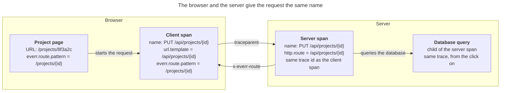

Tuesday morning, a customer writes to support: "I clicked Save on the project page and nothing happened." No screenshot, no exact time, no error message.

The frontend team says the request went out. The backend team says requests are succeeding. Half a day later, someone finds the cause: a timeout between two services that only shows up from that one page.

Good observability tells you what happened before, during, and after a problem like this. In this post we look at why that matters even more now that AI agents are part of how bugs get fixed, and at a detail that decides whether it works: connecting what the browser records with what the server records, at the right cardinality.

## Distributed tracing in two minutes

A trace is the full story of one request, from the user's click to the last database query. It is made of spans. Each span is one operation, with a name, a start, an end, an outcome, and attributes.

Spans form a tree. The click triggers a fetch in the browser, the fetch reaches the server, the server calls another service, and that service queries the database. Each step is a child of the one before, and they all share one trace id.

What holds the tree together is context propagation. The [W3C Trace Context](https://www.w3.org/TR/trace-context/) standard defines the `traceparent` header, which travels with every request and carries the caller's trace id and span id:

```
traceparent: 00-4bf92f3577b34da6a3ce929d0e0e4736-00f067aa0ba902b7-01
```

Whoever receives the request reads the header and attaches their own spans to the same trace. A request that crosses five services becomes one waterfall you can read top to bottom.

[OpenTelemetry](https://opentelemetry.io/) is the open standard for producing and shipping this data: the APIs, the SDKs, the OTLP protocol, and the semantic conventions that give attributes shared names. Telemetry written with OpenTelemetry isn't tied to a vendor. The same data can go to any compatible backend.

## Start from the session, not the request

A trace follows a request. But the customer didn't report a request. They described something they did, on some page, at a time they don't remember exactly. Before you can open the right trace, you have to find that moment, and the way in is the session.

`@everr/otel-web`, the browser library we get to below, stamps `session.id` on every record it sends: page views, clicks, errors, network spans. A session stays open while the user is active and ends after 30 minutes of inactivity. Filter on one `session.id` and you get everything that user did, in order.

To tie a session to a person, the app calls `identify` after login:

```ts
import { identify } from "@everr/otel-web";

identify(user.id, { plan: user.plan });
```

From then on every record also carries `user.id`, plus traits such as `user.plan`. So the path from a support ticket is short: customer → `user.id` → their sessions → the exact sequence of the project page, the click on Save, and the request that followed. The click and the request aren't parent and child, but they share a session and a page view (`everr.page_view.id`), and that is enough to line them up.

That request is the client span at the root of the trace. From there, distributed tracing takes over: follow the trace id down into the server's spans until you reach the one that timed out.

## Why this matters more with AI agents

AI agents have made writing code much faster. That moved the bottleneck. The slow part now sits between a problem being reported and someone knowing where to look.

An agent fixing a bug needs context, just like a developer. Given "saving doesn't work" and no data, an agent reads the code, forms a hypothesis, and tries it. Sometimes it's right. When it's wrong, it's wrong with great confidence.

With telemetry it can start from facts instead:

1. take the customer's `user.id` and find their sessions;
2. see the click on Save and the request it sent;
3. follow the trace down to the server span that timed out;
4. open the file that handles that route and propose a fix.

The other signals fill in the picture. Logs written during the request carry the same `trace_id` and `span_id`, so they sit right next to the spans. Metrics tell you whether this was one unlucky user or whether the endpoint times out for everyone.

The agent reaches the fix with evidence that it is fixing the problem the user actually hit, not a plausible-looking neighbour. The decision still belongs to whoever reviews the change, but now they have the evidence to judge it.

All of this has one precondition: the agent has to filter and join on keys that are stable and predictable. That's where cardinality comes in.

## The cardinality problem in URLs

Cardinality is the number of distinct values an attribute can take. `http.request.method` has low cardinality: GET, POST, PUT, and a few others. A user id has very high cardinality.

URLs are the sneaky case, because they look low-cardinality and aren't. To your code, these three requests are the same operation:

```
GET /api/projects/8f3a2c/members
GET /api/projects/19bd04/members
GET /api/projects/e77c51/members
```

If the span is named after the path, every project produces a different name. Thousands of projects, thousands of names, and three things break:

- **Aggregation stops working.** "What's the p95 latency of the members endpoint?" has no answer, because the endpoint is spread across thousands of rows.
- **Queries get slow.** Every distinct value is another series to store and scan, and backends that pre-aggregate by span name make you pay for each new one.
- **Correlation breaks.** The browser and the server call the same operation by different names, and joining them takes regular expressions and patience.

The fix is to name the route template, not the concrete URL. There is exactly one `/api/projects/{id}/members`, whatever the project. The [OpenTelemetry HTTP semantic conventions](https://opentelemetry.io/docs/specs/semconv/http/http-spans/) spell this out: `http.route` on server spans, `url.template` on client spans, and a span name of `{method} {template}`. They're explicit about what not to do, too: the concrete path must not stand in for the template, and instrumentation should use the routing information the framework provides.

| Attribute      | Where       | Cardinality | Example                                               |
| -------------- | ----------- | ----------- | ----------------------------------------------------- |
| `http.route`   | server span | low         | `/api/projects/{id}/members`                          |
| `url.template` | client span | low         | `/api/projects/{id}/members`                          |
| `url.path`     | server span | high        | `/api/projects/8f3a2c/members`                        |
| `url.full`     | client span | high        | `https://app.example.com/api/projects/8f3a2c/members` |

You don't lose the concrete URL. It stays in `url.path` and `url.full`, where it's useful for a single investigation. Grouping, span names, and alerts use the template.

On the server this is usually easy, because the framework knows which route handled the request. In the browser it isn't. The code that calls `fetch` only sees a string, and the current page is just `location.href`. So client telemetry ends up grouped by URL, and cardinality explodes right where your users are.

## Routes, not URLs: how @everr/otel-web handles it

[`@everr/otel-web`](https://github.com/everr-labs/everr/tree/main/packages/otel-web) is our open source browser telemetry library, under the Apache 2.0 license. It captures page views, interactions, web vitals, errors, and network requests, and exports them as standard OTLP. It isn't tied to Everr: the `endpoint` option takes any OpenTelemetry collector, and data arrives on `/v1/logs` and `/v1/traces` like it would from any other SDK. It also strips the query string before recording a request's `url.full`, since query strings can hold tokens or personal data.

### Requests: let the server name the route

The browser usually doesn't know the route of an API request. Its router has never heard of server-only routes. The server does know, so the main path goes through the response. When the server answers with an `x-everr-route` header, the library uses that value as the client span's `url.template` and puts it in the span name:

```
HTTP/1.1 200 OK
x-everr-route: /api/projects/{id}/members
```

The server already has this value: it's the template the framework used to route the request, the same one that lands in `http.route` on its own spans. It just has to send it back. With TanStack Start, the middleware in [`@everr/tanstack-start-otel`](https://github.com/everr-labs/everr/tree/main/packages/tanstack-start-otel) does it for you. Elsewhere it takes a few lines. Here's Fastify:

```ts
fastify.addHook("onRequest", async (request, reply) => {
  // Fastify writes "/api/projects/:id/members"; send "/api/projects/{id}/members"
  const route = request.routeOptions.url?.replace(/:(\w+)/g, "{$1}");
  if (route) reply.header("x-everr-route", route);
});
```

Every framework spells parameters its own way: Fastify writes `:id`, TanStack writes `$id`. Pick one form (we use `{id}`) and use it both in the header and in `http.route` on the server's spans. Then the browser and the server give the request the same name, with no route configuration in the browser at all. For cross-origin requests, the server also has to list the header in `Access-Control-Expose-Headers`, or the browser won't let the library read it.

When the server can't send the header, say a third-party API or a service you don't own, you can compute the template in the browser with the `request` resolver:

```ts
import { setRouteResolver } from "@everr/otel-web";

const apiRoutes: [RegExp, string][] = [
  [/^\/api\/projects\/[^/]+\/members$/, "/api/projects/{id}/members"],
  [/^\/api\/projects\/[^/]+$/, "/api/projects/{id}"],
];

setRouteResolver({
  request: (url) => apiRoutes.find(([pattern]) => pattern.test(url.pathname))?.[1],
});
```

If both are present, the header wins. The server has the last word.

### Pages: let the router name the route

Pages are the opposite case: the browser's router is the one that knows. The `page` resolver turns the page URL into a route, and the library writes it as `everr.route.pattern` on every record, whether it's a page view, a click, a web vital, an error, or a span. With TanStack Router it's a few lines:

```ts
setRouteResolver({
  page: (url) => {
    const match = router.matchRoutes(new URL(url).pathname).at(-1);
    // an unknown page gets no route rather than a made-up one
    if (!match || match.routeId === "__root__") return undefined;
    // TanStack writes "/projects/$id"; use "/projects/{id}"
    return match.fullPath.replace(/\$(\w+)/g, "{$1}");
  },
});
```

Each `setRouteResolver` call replaces the previous one, so if you need both resolvers, pass them in the same object.

## Correlation for free

Once the browser and the server use the same names, hard questions become simple queries:

- **"Which pages have the worst LCP?"** Group web vitals by `everr.route.pattern`. `/projects/{id}` is one row, not ten thousand.
- **"Are this page's JavaScript errors caused by a slow API?"** Errors and network spans share the page route and the session. Join them.
- **"Is this endpoint slow for everyone, or only from one page?"** Client and server spans share the template, so the latency the browser saw lines up directly with what the server measured.

Propagation does the rest. The library adds `traceparent` to same-origin requests and to origins listed in `tracePropagationTargets`, so the browser span and the server span land in the same trace. For another origin, the browser sends a CORS preflight first, so the server must allow `traceparent` in `Access-Control-Allow-Headers` or the request fails.



The request carries `traceparent`, so the server span joins the trace. The response carries `x-everr-route`, so the client span takes the server's template.

One last benefit, maybe the most underrated. A route like `/projects/{id}` isn't just a label: it points at code. With file-based routing it leads straight to the file that renders the page. For an AI agent, that's the missing link between "the user saw an error" and "here's the file to change".

## Getting started

One package and a few lines:

```bash
pnpm add @everr/otel-web
```

```ts
import {
  errors,
  identify,
  interactions,
  network,
  pageviews,
  performance,
  WebSDK,
} from "@everr/otel-web";

new WebSDK({
  serviceName: "acme-web",
  endpoint: "https://otel-collector.example.com", // any OTLP collector
  instrumentations: [errors(), interactions(), pageviews(), performance(), network()],
});

// after login
identify(user.id);
```

Then send `x-everr-route` from your server, or register the resolvers shown above, and every record goes out with its route. The code is on [GitHub](https://github.com/everr-labs/everr/tree/main/packages/otel-web). If Everr is your backend, our CLI lets agents query this data from the terminal. If you use another OpenTelemetry backend, the data is exactly the same.

Distributed tracing has always promised to tell you where something broke. With the right route on every record, and an agent that can read it, that promise reaches all the way to the fix.
