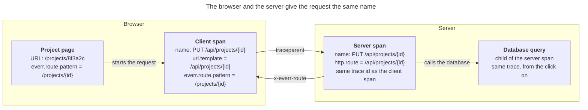

Tuesday morning, a customer writes to support: "I clicked Save on the project page and nothing happened." No screenshot, no exact time, no error message.

Observability, done well, tells us what happened before, after, and during the problem. In this article we look at why it matters even more today, with AI agents in the development loop, and why so much depends on a detail that often gets overlooked: connecting the signals that come from the client and the server, with the right cardinality.

## Distributed tracing

A trace is the full story of a request, from the user's click to the last database query. It is made of spans: each span is an operation with a name, a start, an end, an outcome, and attributes.

Spans are linked by parent and child relationships. The click starts a fetch in the browser, the fetch reaches the server, the server calls another service, and that service queries the database. Each step is a child of the previous one, and they all share the same trace id.

The glue is context propagation. The [W3C Trace Context](https://www.w3.org/TR/trace-context/) standard defines the `traceparent` header, which travels with every request and carries the caller's trace id and span id:

```
traceparent: 00-4bf92f3577b34da6a3ce929d0e0e4736-00f067aa0ba902b7-01
```

Whoever receives the request reads the header and attaches its own spans to the same trace. A request that crosses five services becomes a single waterfall, readable from top to bottom.

[OpenTelemetry](https://opentelemetry.io/) is the open standard that today defines how to produce and transport this data: APIs, SDKs, the OTLP protocol, and the semantic conventions, the shared names for attributes. Writing telemetry with OpenTelemetry means you are not tied to a vendor: the same data can go to any compatible backend.

## Identifying a session

A trace follows a request. But the customer did not report a request: they described a gesture, on a page, at a moment they don't remember precisely. Before reaching the right trace, you have to find that moment again, and the thread to pull is the session.

`@everr/otel-web`, the browser library we cover later on, writes the `session.id` attribute on every record it emits: page views, clicks, errors, network spans. A session stays open while the user is active and closes after 30 minutes of inactivity. A single filter on `session.id` gives you everything the user did, in time order.

What remains is to connect the session to the person who wrote to support. After login, the application calls `identify`:

```ts
import { identify } from "@everr/otel-web";

identify(user.id, { plan: user.plan });
```

From then on every record also carries `user.id`, and traits such as `user.plan`. From the customer you get to their `user.id`, from the `user.id` to their sessions, and from a session to the exact sequence: the project page, the click on Save, the request sent right after. The click and the request are not parent and child, but they share the session and the page view (`everr.page_view.id`), and that is enough to put them in order.

The request is the client span that opens the trace. From here the work moves to distributed tracing: from the trace id you go down into the server spans, all the way to the one that timed out.

## Why it matters even more with AI

AI agents have made writing code much faster. The bottleneck has moved: today time is lost between the report of a problem and the moment someone understands where to look.

An agent that has to fix a bug needs context, just like a developer. Faced with "saving doesn't work", an agent without data reads the code, forms hypotheses, and tries things. Sometimes it guesses right. When it is wrong, it is wrong with great confidence.

With observability the path changes, because the agent can query the telemetry and start from the facts:

1. it starts from the `user.id` of the customer who wrote to support and finds their sessions, each with its `session.id`;
2. it sees the click on Save and the request it sent;
3. it follows the trace down to the server span that timed out;
4. it opens the file that handles that route and proposes a fix.

The other signals complete the picture. The logs written during the request carry the same `trace_id` and `span_id`, so they read alongside the spans. The metrics tell you whether the case is isolated or the same endpoint times out for everyone.

This lets the agent reach a fix with concrete proof that what it is fixing really is the problem the user hit. The decision on the fix stays with whoever reviews the change, but now they have the evidence to judge it.

There is one condition, though. For the agent to follow this path, the data needs stable, predictable keys to filter and join on. This is where cardinality comes in.

## The cardinality problem in URLs

Cardinality is the number of distinct values an attribute can take. `http.request.method` has low cardinality: GET, POST, PUT, and a few others. A user id has very high cardinality.

URLs are the trickiest case, because they look low cardinality and they are not. To the code, these three requests are the same operation:

```
GET /api/projects/8f3a2c/members
GET /api/projects/19bd04/members
GET /api/projects/e77c51/members
```

If the span takes its name from the path, every project produces a different name. With thousands of projects you get thousands of names, and three things happen:

- **Aggregations stop working.** "What is the p95 latency of the members endpoint?" has no answer, because the endpoint is spread across thousands of rows.
- **Queries get much slower.** Every distinct value is one more series to store and scan, and in backends that pre-aggregate by span name every new name has a cost.
- **Correlations break.** The browser and the server call the same operation by different names, and joining their data takes regular expressions and patience.

The solution is to use the route template instead of the concrete URL. `/api/projects/{id}/members` is a single value, whatever the project. The [OpenTelemetry HTTP semantic conventions](https://opentelemetry.io/docs/specs/semconv/http/http-spans/) call for exactly this: `http.route` on server spans, `url.template` on client spans, and the span name becomes `{method} {template}`. The conventions are also explicit about what not to do: the concrete path cannot take the place of the template, and the instrumentation must use the framework's routing information.

| Attribute      | Where       | Cardinality | Example                                               |
| -------------- | ----------- | ----------- | ----------------------------------------------------- |
| `http.route`   | server span | low         | `/api/projects/{id}/members`                          |
| `url.template` | client span | low         | `/api/projects/{id}/members`                          |
| `url.path`     | server span | high        | `/api/projects/8f3a2c/members`                        |
| `url.full`     | client span | high        | `https://app.example.com/api/projects/8f3a2c/members` |

The concrete URL is not lost: it stays in `url.path` and `url.full`, useful when you investigate a single case. Groupings, span names, and alerts use the template instead.

On the server the problem is usually easy to solve, because the framework knows which route handled the request. In the browser it is not. The code that calls `fetch` only sees a string, and the current page is just `location.href`. So client telemetry ends up grouped by URL, and cardinality explodes exactly where the user lives.

## Routes, not URLs: how @everr/otel-web solves it

[`@everr/otel-web`](https://github.com/everr-labs/everr/tree/main/packages/otel-web) is our open source library, under the Apache 2.0 license, for browser telemetry. It captures page views, interactions, web vitals, errors, and network requests, and exports them as standard OTLP. It is vendor agnostic: the `endpoint` option accepts any OpenTelemetry collector, and the data arrives on `/v1/logs` and `/v1/traces` like from any other SDK. It strips the query string from request URLs before storing them in `url.full`, because it can contain tokens or personal data.

### Requests: the server names the route

The client often lacks the information to resolve a route, which is why Everr supports header-based resolution.
If the server responds with the `x-everr-route` header, the library uses that value as the client span's `url.template` and puts it in the span name:

```
HTTP/1.1 200 OK
x-everr-route: /api/projects/{id}/members
```

The server already has this value, because it is the same template the framework used to route the request, and the one that ends up in `http.route` on its spans. It only has to send it back. With TanStack Start, the middleware in [`@everr/tanstack-start-otel`](https://github.com/everr-labs/everr/tree/main/packages/tanstack-start-otel) already does it. With other frameworks it takes a few lines, for example with Fastify:

```ts
fastify.addHook("onRequest", async (request, reply) => {
  // Fastify writes "/api/projects/:id/members": it becomes "/api/projects/{id}/members"
  const route = request.routeOptions.url?.replace(/:(\w+)/g, "{$1}");
  if (route) reply.header("x-everr-route", route);
});
```

Each framework has its own parameter syntax: Fastify writes `:id`, TanStack `$id`. Pick one, here `{id}`, and use it both in the header and in `http.route` on the server spans. That way the browser and the server give the request the same name, without a line of configuration in the browser. For cross-origin requests the server must expose the header with `Access-Control-Expose-Headers`, otherwise the browser does not make it readable.

When the server cannot send the header, for example a third-party API or a service you don't control, the route is computed in the browser with the `request` resolver of `setRouteResolver`. It receives the request URL and returns the template:

```ts
import { setRouteResolver } from "@everr/otel-web";

const apiRoutes: [RegExp, string][] = [
  [/^\/api\/projects\/[^/]+\/members$/, "/api/projects/{id}/members"],
  [/^\/api\/projects\/[^/]+$/, "/api/projects/{id}"],
];

setRouteResolver({
  request: (url) => apiRoutes.find(([pattern]) => pattern.test(url.pathname))?.[1],
});
```

If both the header and the resolver are present, the header wins: the server has the last word.

## Automatic trace correlation

When the browser and the server use the same names, the hard questions become simple queries:

- **"Which pages have the worst LCP?"** Group the web vitals by `everr.route.pattern`, and `/projects/{id}` is a single row, not ten thousand.
- **"Do the JavaScript errors on this page come from a slow API?"** Errors and network spans share the page route and the session: just join them.
- **"Is this endpoint slow for everyone or only from one page?"** Client and server spans share the same template, so the latency seen by the browser compares directly with the one measured by the server.

Propagation does the rest. The library adds `traceparent` to requests to the same origin, and to the origins listed in `tracePropagationTargets`. That way the browser span and the server span end up in the same trace. For a different origin the browser first sends a CORS preflight request, so the server must accept the `traceparent` header in `Access-Control-Allow-Headers`, otherwise the request fails.



The request carries `traceparent` and the server span joins the same trace. The response carries `x-everr-route` and the client span takes the server's template.

There is one last advantage, maybe the most underrated. A route like `/projects/{id}` is not just a label: it is a pointer to the code. With file-based routing it leads straight to the file that handles the page, and for an AI agent it is the missing link between "the user saw an error" and "here is the file to change".

## Getting started

All it takes is one package and a few lines:

```bash
pnpm add @everr/otel-web
```

```ts
import { errors, network, pageviews, performance, WebSDK } from "@everr/otel-web";

new WebSDK({
  serviceName: "acme-web",
  endpoint: "https://otel-collector.example.com", // any OTLP collector
  instrumentations: [errors(), pageviews(), performance(), network()],
});
```

Then register the route resolver, as shown above, and every record goes out with its route. The code is on [GitHub](https://github.com/everr-labs/everr/tree/main/packages/otel-web). If you use Everr as your backend, our CLI also lets agents query this data from the terminal. If you use another OpenTelemetry backend, the data is exactly the same.
