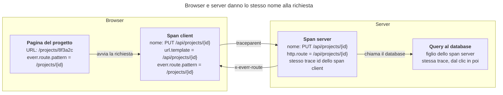

Martedì mattina un cliente scrive al supporto: «Ho cliccato su Salva nella pagina del progetto e non è successo niente». Nessuno screenshot, nessun orario preciso, nessun messaggio di errore.

L'observability, fatta bene, ci racconta cosa è successo prima, dopo e durante la problematica. In questo articolo vediamo perché oggi, con gli agenti AI nel ciclo di sviluppo, vale ancora di più, e perché molto dipende da un dettaglio che spesso si trascura: collegare i segnali che arrivano dal client e server, con la giusta cardinalità.

## Distributed tracing

Una trace è la storia completa di una richiesta, dal clic dell'utente fino all'ultima query sul database. È fatta di span: ogni span è un'operazione con un nome, un inizio, una fine, un esito e degli attributi.

Gli span sono legati da relazioni padre e figlio. Il clic genera una fetch nel browser, la fetch arriva al server, il server chiama un altro servizio, quel servizio interroga il database. Ogni passaggio è figlio del precedente e tutti condividono lo stesso trace id.

Il collante è la propagazione del contesto. Lo standard [W3C Trace Context](https://www.w3.org/TR/trace-context/) definisce l'header `traceparent`, che viaggia con ogni richiesta e porta il trace id e lo span id del chiamante:

```
traceparent: 00-4bf92f3577b34da6a3ce929d0e0e4736-00f067aa0ba902b7-01
```

Chi riceve la richiesta legge l'header e attacca i propri span alla stessa trace. Così una richiesta che attraversa cinque servizi diventa un'unica cascata, leggibile dall'alto in basso.

[OpenTelemetry](https://opentelemetry.io/) è lo standard aperto che oggi definisce come produrre e trasportare questi dati: API, SDK, il protocollo OTLP e le semantic conventions, cioè i nomi condivisi degli attributi. Scrivere telemetria in OpenTelemetry significa non legarsi a un fornitore: gli stessi dati possono andare a qualunque backend compatibile.

## Identificare una sessione

Una trace segue una richiesta. Il cliente però non ha segnalato una richiesta: ha raccontato un gesto, su una pagina, in un momento che non ricorda con precisione. Prima di arrivare alla trace giusta bisogna ritrovare quel momento, e il filo è la sessione.

`@everr/otel-web`, la libreria per il browser di cui parliamo più avanti, scrive l'attributo `session.id` su ogni record che emette: page view, clic, errori, span di rete. Una sessione resta aperta finché l'utente è attivo e si chiude dopo 30 minuti di inattività. Con un solo filtro su `session.id` si ottiene tutto quello che l'utente ha fatto, in ordine di tempo.

Resta da collegare la sessione alla persona che ha scritto al supporto. Dopo il login l'applicazione chiama `identify`:

```ts
import { identify } from "@everr/otel-web";

identify(user.id, { plan: user.plan });
```

Da quel momento ogni record porta anche `user.id`, e i tratti come `user.plan`. Dal cliente si passa al suo `user.id`, dal `user.id` alle sue sessioni, e da una sessione alla sequenza esatta: la pagina del progetto, il clic su Salva, la richiesta partita subito dopo. Il clic e la richiesta non sono padre e figlio, ma condividono la sessione e la page view (`everr.page_view.id`), e questo basta a metterli in fila.

La richiesta è lo span client che apre la trace. Da qui il lavoro passa al distributed tracing: dal trace id si scende negli span del server, fino a quello andato in timeout.

## Perché con l'AI vale ancora di più

Gli agenti AI hanno reso la scrittura del codice molto più veloce. Il collo di bottiglia si è spostato: oggi il tempo si perde tra la segnalazione di un problema e il momento in cui qualcuno capisce dove mettere le mani.

Un agente che deve correggere un bug ha bisogno di contesto, come uno sviluppatore. Davanti a «il salvataggio non funziona», un agente senza dati legge il codice, formula ipotesi e prova. A volte indovina. Quando sbaglia, sbaglia con grande sicurezza.

Con l'observability il percorso cambia, perché l'agente può interrogare la telemetria e partire dai fatti:

1. parte dal `user.id` del cliente che ha scritto al supporto e trova le sue sessioni, ognuna con il suo `session.id`;
2. vede il clic su Salva e la richiesta che ne è partita;
3. segue la trace fino allo span del server andato in timeout;
4. apre il file che gestisce quella rotta e propone una correzione.

Gli altri segnali completano il quadro. I log scritti durante la richiesta portano lo stesso `trace_id` e `span_id`, quindi si leggono accanto agli span. Le metriche dicono se il caso è isolato o se lo stesso endpoint va in timeout per tutti.

Questo permette all'agente di arrivare al fix con una prova concreta che quello che sta correggendo è veramente il problema che ha colpito l'utente. La decisione sul fix resta a chi rivede la modifica, ma ora ha le prove per valutarla.

C'è però una condizione. Perché l'agente possa fare questo percorso, i dati devono avere chiavi stabili e prevedibili su cui filtrare e unire. Ed è qui che entra in gioco la cardinalità.

## Il problema della cardinalità nelle URL

La cardinalità è il numero di valori distinti che un attributo può assumere. `http.request.method` ha cardinalità bassa: GET, POST, PUT e pochi altri. Un id utente ha cardinalità altissima.

Le URL sono il caso più insidioso, perché sembrano a bassa cardinalità e non lo sono. Per il codice, queste tre richieste sono la stessa operazione:

```
GET /api/projects/8f3a2c/members
GET /api/projects/19bd04/members
GET /api/projects/e77c51/members
```

Se lo span prende il nome dal path, ogni progetto genera un nome diverso. Con migliaia di progetti si hanno migliaia di nomi, e succedono tre cose:

- **Le aggregazioni smettono di funzionare.** «Qual è la latenza p95 dell'endpoint dei membri?» non ha risposta, perché l'endpoint è sparso su migliaia di righe.
- **Le query sono molto più lente.** Ogni valore distinto è una serie in più da salvare e da scorrere, e nei backend che pre-aggregano per nome di span ogni nome nuovo si paga.
- **Le correlazioni si rompono.** Browser e server chiamano la stessa operazione in modi diversi, e unire i loro dati richiede espressioni regolari e pazienza.

La soluzione è usare il template della rotta al posto dell'URL concreta. `/api/projects/{id}/members` è uno solo, qualunque sia il progetto. Le [semantic conventions HTTP di OpenTelemetry](https://opentelemetry.io/docs/specs/semconv/http/http-spans/) lo prevedono: `http.route` sugli span del server, `url.template` su quelli del client, e il nome dello span diventa `{metodo} {template}`. Le convenzioni sono esplicite anche su cosa non fare: il path concreto non può prendere il posto del template, e l'instrumentazione deve usare le informazioni di routing del framework.

| Attributo      | Dove        | Cardinalità | Esempio                                               |
| -------------- | ----------- | ----------- | ----------------------------------------------------- |
| `http.route`   | span server | bassa       | `/api/projects/{id}/members`                          |
| `url.template` | span client | bassa       | `/api/projects/{id}/members`                          |
| `url.path`     | span server | alta        | `/api/projects/8f3a2c/members`                        |
| `url.full`     | span client | alta        | `https://app.example.com/api/projects/8f3a2c/members` |

L'URL concreta non si perde: resta in `url.path` e `url.full`, utile quando si indaga sul singolo caso. I raggruppamenti, i nomi degli span e gli alert si fanno invece sul template.

Solitamente lato server il problema è di facile soluzione, perché il framework sa quale rotta ha gestito la richiesta. Lato browser no. Il codice che chiama `fetch` vede solo una stringa, e la pagina corrente è solo `location.href`. Così la telemetria del client finisce raggruppata per URL, e la cardinalità esplode proprio dove l'utente vive.

## Rotte, non URL: come lo risolve @everr/otel-web

[`@everr/otel-web`](https://github.com/everr-labs/everr/tree/main/packages/otel-web) è la nostra libreria open source, con licenza Apache 2.0, per la telemetria del browser. Cattura page view, interazioni, web vitals, errori e richieste di rete, e li esporta in OTLP standard. È vendor agnostica: l'opzione `endpoint` accetta qualunque collector OpenTelemetry, e i dati arrivano su `/v1/logs` e `/v1/traces` come da qualunque altro SDK. Dall'URL delle richieste toglie la query string prima di salvarla in `url.full`, perché può contenere token o dati personali.

### Le richieste: la rotta la dice il server

Spesso al client manca l'informazione su come risolvere una rotta, per questo motivo Everr supporta una risoluzione basata su header.
Se il server risponde con l'header `x-everr-route`, la libreria usa quel valore come `url.template` dello span client e lo mette nel nome dello span:

```
HTTP/1.1 200 OK
x-everr-route: /api/projects/{id}/members
```

Il server ha già questo valore, perché è lo stesso template che il framework ha usato per instradare la richiesta e che finisce in `http.route` sui suoi span. Basta rimandarlo indietro. Con TanStack Start lo fa già il middleware di [`@everr/tanstack-start-otel`](https://github.com/everr-labs/everr/tree/main/packages/tanstack-start-otel). Con altri framework bastano poche righe, per esempio con Fastify:

```ts
fastify.addHook("onRequest", async (request, reply) => {
  // Fastify scrive "/api/projects/:id/members": diventa "/api/projects/{id}/members"
  const route = request.routeOptions.url?.replace(/:(\w+)/g, "{$1}");
  if (route) reply.header("x-everr-route", route);
});
```

Ogni framework ha la sua sintassi per i parametri: Fastify scrive `:id`, TanStack `$id`. Conviene sceglierne una sola, qui `{id}`, e usarla sia nell'header sia in `http.route` sugli span del server. Così browser e server danno alla richiesta lo stesso nome, senza una riga di configurazione nel browser. Per le richieste cross-origin il server deve esporre l'header con `Access-Control-Expose-Headers`, altrimenti il browser non lo rende leggibile.

Quando il server non può mandare l'header, per esempio un'API di terze parti o un servizio che non controllate, la rotta si calcola nel browser con il resolver `request` di `setRouteResolver`. Riceve l'URL della richiesta e restituisce il template:

```ts
import { setRouteResolver } from "@everr/otel-web";

const apiRoutes: [RegExp, string][] = [
  [/^\/api\/projects\/[^/]+\/members$/, "/api/projects/{id}/members"],
  [/^\/api\/projects\/[^/]+$/, "/api/projects/{id}"],
];

setRouteResolver({
  request: (url) => apiRoutes.find(([pattern]) => pattern.test(url.pathname))?.[1],
});
```

Se ci sono sia l'header sia il resolver, vince l'header: il server ha l'ultima parola.

## Correlazione automatica delle traces

Quando browser e server usano gli stessi nomi, le domande difficili diventano query semplici:

- **«Quali pagine hanno l'LCP peggiore?»** Si raggruppano i web vitals per `everr.route.pattern`, e `/projects/{id}` è una riga sola, non diecimila.
- **«Gli errori JavaScript di questa pagina dipendono da una API lenta?»** Errori e span di rete hanno la stessa rotta di pagina e la stessa sessione: basta unirli.
- **«Questo endpoint è lento per tutti o solo da una pagina?»** Span client e span server hanno lo stesso template, quindi la latenza vista dal browser si confronta direttamente con quella misurata dal server.

La propagazione fa il resto. La libreria aggiunge `traceparent` alle richieste verso la stessa origine, e verso le origini elencate in `tracePropagationTargets`. Così lo span del browser e quello del server finiscono nella stessa trace. Per un'origine diversa il browser invia prima una richiesta preflight CORS, quindi il server deve accettare l'header `traceparent` in `Access-Control-Allow-Headers`, altrimenti la richiesta fallisce.



La richiesta porta `traceparent` e lo span del server entra nella stessa trace. La risposta porta `x-everr-route` e lo span client prende il template del server.

C'è un ultimo vantaggio, forse il più sottovalutato. Una rotta come `/projects/{id}` non è solo un'etichetta: è un puntatore al codice. Con il routing basato sui file porta dritti al file che gestisce la pagina, e per un agente AI è il collegamento che mancava tra «l'utente ha visto un errore» e «ecco il file da modificare».

## Come iniziare

Bastano un pacchetto e poche righe:

```bash
pnpm add @everr/otel-web
```

```ts
import { errors, network, pageviews, performance, WebSDK } from "@everr/otel-web";

new WebSDK({
  serviceName: "acme-web",
  endpoint: "https://otel-collector.example.com", // qualunque collector OTLP
  instrumentations: [errors(), pageviews(), performance(), network()],
});
```

Poi si registra il resolver delle rotte, come visto sopra, e ogni record esce con la sua rotta. Il codice è su [GitHub](https://github.com/everr-labs/everr/tree/main/packages/otel-web). Se usate Everr come backend, la nostra CLI permette anche agli agenti di interrogare questi dati dal terminale. Se usate un altro backend OpenTelemetry, i dati sono esattamente gli stessi.
